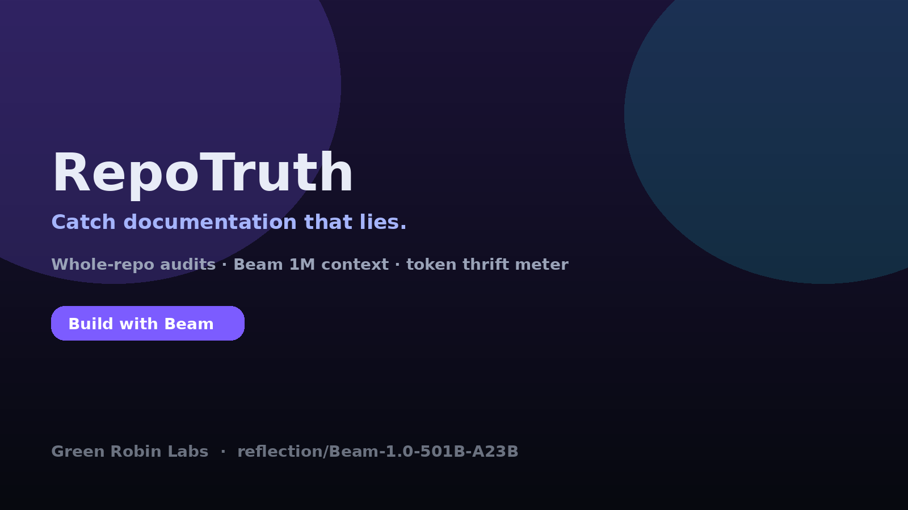

<p align="center">
  
</p>

# RepoTruth

**Catch documentation that lies.**

RepoTruth packs an entire repository into **one [Beam](https://huggingface.co/reflection/Beam-1.0-501B-A23B) call**, finds places where the docs contradict the code, and shows a live **token thrift meter** — Beam’s ~3× leaner reasoning, made visible.

Built by **Green Robin Labs** for the Hugging Face × Reflection [Build with Beam](https://huggingface.co/reflection/Beam-1.0-501B-A23B/discussions/5) challenge ($20K).

| Artifact | Link |
|----------|------|
| Live Space | https://huggingface.co/spaces/mr-dee/repotruth |
| Findings dataset | https://huggingface.co/datasets/mr-dee/repotruth-findings |
| Landing | https://repotruth.vercel.app |
| Model | `Beam-1.0-501B-A23B` via Reflection API or HF Inference Providers |

## Why this shows off Beam

| Beam strength | How RepoTruth uses it |
|---------------|------------------------|
| **1M context** | Packs README + docs + source into a single audit prompt |
| **Agentic coding / SWE** | Judges functional lies (flags, defaults, exit codes, control flow) |
| **Token-efficient reasoning** | Live thrift meter + `reasoning_effort` control |

## Quick start

```bash
# Fixture demo (no API key)
REPOTRUTH_BACKEND=mock python scripts/repotruth_cli.py fixtures/tinyclick

# Reflection API
export REFLECTION_API_KEY=...
REPOTRUTH_BACKEND=reflection python scripts/repotruth_cli.py fixtures/tinyclick

# HF Inference Providers
export HF_TOKEN=...   # needs Inference Providers permission
REPOTRUTH_BACKEND=hf python scripts/repotruth_cli.py fixtures/tinyclick
```

Gradio locally:

```bash
cd space && pip install -r requirements.txt && python app.py
```

## Fixtures

Intentionally lying mini-repos for demos and tests:

- `tinyclick` — wrong CLI flags / exit codes
- `tinystar` — middleware order + path syntax lies
- `tinyhttp` — wrong defaults + `.json()` claims

## Judging rubric fit

- **Creativity** — visual autopsy of docs that lie, not a chat wrapper
- **Technical execution** — packer, structured JSON schema, dual backends, fixture mode
- **Usefulness** — maintainers and agents waste hours on stale docs
- **Use of Beam** — 1M context + SWE strength + thrift meter

## License

Apache-2.0. Affiliation in public copy: Green Robin Labs.
