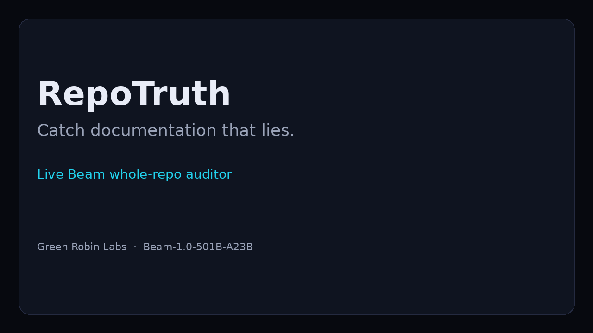

<p align="center">
  
</p>

# RepoTruth

**Catch documentation that lies.**

RepoTruth packs an entire repository into **one [Beam](https://huggingface.co/reflection/Beam-1.0-501B-A23B) call**, finds places where the docs contradict the code, and shows a **measured token thrift meter**.

Built by **Green Robin Labs** for the Hugging Face × Reflection [Build with Beam](https://huggingface.co/reflection/Beam-1.0-501B-A23B/discussions/5) challenge ($20K).

[](https://github.com/dl88jing/repotruth/actions/workflows/ci.yml)

## Demo video

Simulated-user screen recording of the live auditor on [repotruth.vercel.app](https://repotruth.vercel.app).

[](https://youtu.be/oI5lOF2bS2g)

- **YouTube:** https://youtu.be/oI5lOF2bS2g
- **MP4 (fallback):** [repotruth-demo-v2.mp4](https://github.com/dl88jing/repotruth/releases/download/v0.3.0/repotruth-demo-v2.mp4)


| Artifact | Link |
|----------|------|
| **Live auditor (judges)** | https://repotruth.vercel.app/#auditor |
| HF Space (measured results) | https://huggingface.co/spaces/mr-dee/repotruth |
| Findings dataset | https://huggingface.co/datasets/mr-dee/repotruth-findings |
| Demo video | https://youtu.be/oI5lOF2bS2g · [MP4](https://github.com/dl88jing/repotruth/releases/download/v0.3.0/repotruth-demo-v2.mp4) |
| Deck | [RepoTruth-Build-with-Beam.pptx](deck/RepoTruth-Build-with-Beam.pptx) |
| Model | `Beam-1.0-501B-A23B` via Reflection OpenAI-compatible API |

## For judges (Oct 31, 2026 PT)

```bash
# Health — should show reflection_key_present:true + github_audit:true
curl -s https://repotruth.vercel.app/api/health | jq .

# Live fixture audit
curl -s -X POST https://repotruth.vercel.app/api/audit \
  -H 'content-type: application/json' \
  -d '{"fixture":"tinyclick","effort":"low"}' \
  | jq '{live, usage:.result.usage, n:(.result.parsed.findings|length), summary:.result.parsed.summary}'

# Live public GitHub audit (rate-limited: ~5/IP/hour, ~150/day; zip≤2.5MB, ≤120 files, ≤280k chars)
curl -s -X POST https://repotruth.vercel.app/api/audit \
  -H 'content-type: application/json' \
  -d '{"github":"https://github.com/pallets/itsdangerous","effort":"low"}' \
  | jq '{live, mode, usage:.result.usage, n:(.result.parsed.findings|length), summary:.result.parsed.summary}'
```

Offline fixture demo (no key):

```bash
git clone https://github.com/dl88jing/repotruth && cd repotruth
./demo.sh
python3 -m pytest -q   # after: pip install -r requirements-dev.txt
```

## Measured results (live Beam, Oct 31, 2026 PT)

### Effort sweep — tinyclick (same 3 findings every time)

| effort | reasoning_tokens | completion_tokens | latency_s |
|--------|-----------------:|------------------:|----------:|
| low    | 246 | 703 | 4.29 |
| medium | 572 | 1157 | 7.22 |
| high   | 580 | 1079 | 7.09 |

**Claim:** `reasoning_effort=low` used **57% fewer** reasoning tokens than `medium` for identical verified findings. We do **not** invent a cross-model ~3× figure from this run.

### Real open-source repos (verified true positives only)

| repo | verified | prompt | reasoning | latency_s |
|------|---------:|-------:|----------:|----------:|
| encode/httpcore | 5 | 56,742 | 4,292 | 36.53 |
| pallets/itsdangerous | 1 | 40,291 | 2,859 | 20.99 |
| psf/requests | 1 | 62,572 | 2,967 | 24.46 |
| Kludex/starlette | 1 | 76,850 | 2,252 | 21.37 |
| pallets/click | 0 | 70,244 | 2,943 | 25.35 |

Featured httpcore highs (re-read in source before keeping):

- Docs call `proxy.request(...)`; `httpcore.Proxy` has no `request` (use `ConnectionPool`)
- Docs show `Request(...).headers` already has Host; constructor leaves headers empty
- TOC lists `httpcore.backends.asyncio.AsyncioBackend` — module does not exist (`AnyIOBackend`)

Full JSON: [`docs/audits/`](docs/audits/) and the Hub [dataset](https://huggingface.co/datasets/mr-dee/repotruth-findings).

### Deterministic citation check (no model in the loop)

Beam proposes findings; `scripts/check_citations.py` re-checks every saved live finding against the source it cites. Fixtures are checked locally. Real repos are fetched at the exact commit in `docs/audits/real_*.json`. It checks that each `doc_refs`/`code_refs` file exists, that any `:LINE` or `:START-END` is in range, and that each backtick-quoted evidence span appears verbatim in the cited files.

Measured Nov 2, 2026 PT, over 10 saved live runs (24 findings):

| check | result |
|-------|-------:|
| cited files that exist | 66 / 66 |
| line ranges in bounds | 6 / 6 |
| findings with all refs valid | 24 / 24 |
| quoted spans found verbatim in cited files | 50 / 53 |

The 3 spans not found verbatim are paraphrases. Two are elided with `...` (`count_p.add_argument("--times", ...)`), and one is a reformatted `pyproject.toml` dependency list. This check catches fabricated paths and lines. It does **not** judge whether a contradiction is true, so the human-verified counts above still stand. Full output: [`docs/audits/citation_check.json`](docs/audits/citation_check.json).

```bash
python3 scripts/check_citations.py                 # fixtures + real repos at pinned commits
python3 scripts/check_citations.py --fixtures-only # offline (what CI runs)
```

## Why this shows off Beam

| Beam strength | How RepoTruth uses it |
|---------------|------------------------|
| **1M context** | Packs README + docs + source into a single audit prompt (56k–77k prompt tokens measured on real repos) |
| **Agentic coding / SWE** | Judges functional lies with file citations we re-verified |
| **Token-efficient reasoning** | Controllable `reasoning_effort`; measured −57% reasoning tokens low vs medium on tinyclick |

## Architecture

```
repo / GitHub zipball ──pack──▶ PackedRepo ──messages──▶ Beam chat.completions
                                                         model: Beam-1.0-501B-A23B
                                                         │
                                                         ▼
                                              JSON findings + usage
                                              (reasoning_tokens from
                                               completion_tokens_details)
```

- **Vercel** (`landing/`): `/api/health`, `/api/audit` — fixtures + public GitHub URLs; `REFLECTION_API_KEY` server-side only
- **Static HF Space** (`space-static/`): measured results + link to live auditor (Gradio free CPU returns HTTP 402)
- **CLI** (`scripts/repotruth_cli.py`): local audits with your own key

## Model name note

Use exactly `Beam-1.0-501B-A23B`. The `reflection/` Hub prefix fails with `model_not_found` on `https://api.reflection.ai/openai/v1`.

## Affiliation

**Green Robin Labs.** Apache-2.0.
